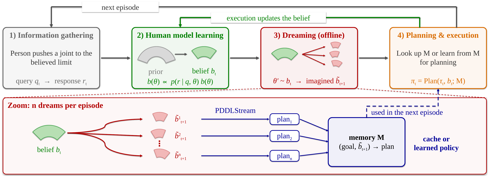

# ABLE: Anticipating Belief Updates for Learning Efficient planning

A robot assisting a person must plan under an unknown person- or home-specific parameter
`theta`. It keeps a *belief* over `theta`; between real episodes it **dreams**: draws
hypothetical people from the belief, solves their tasks with the slow planner, and files the
solutions under the belief it would have next. A model `g` (flow matching) learns from the
dreams to predict `psi`, the planner's proposal, so real planning gets faster.



The limb-only pipeline this grew out of: [its README](doc/limb-dream-pipeline.md).
Background: [NERC abstract](doc/presentations/NERC_Abstract.pdf) ·
[poster](doc/poster/nerc_poster_9_48x36_preview.pdf) ·
[lab meeting slides](<doc/presentations/Lab Meeting 260909.pptx>)

## Tasks

All three tasks implement one API (`src/able/api`) and run through one pipeline.

| | Limb | Friction | Human reach |
|---|---|---|---|
| Task | move a person's arm/leg to a goal pose | push a puck through a floor maze | stock a bedside within a seated person's reach |
| Planner | MPC (fixed wrist/ankle grasp + base) | POMCPOW | PDDLStream |
| `theta` | range-of-motion scales (3 motions) | friction of the blue/tan/green floors | reach ellipsoid (r_x, r_y, r_z) |
| Info gathering | person pushes a joint to its limit; stop angle | probe push on the least-certain floor; slide distance | person reaches as far as possible along a direction; distance |
| Execution feedback | where the limb went (limit crossed / floor) | release speed, stop position | which delivered items the person reached |
| `psi` | MPC torque seed (batch 0 of each step) | POMCPOW push proposals | placement-slot ordering |
| Effort | MPC rollouts | POMCPOW simulations | stream calls |
| Code | `able/tasks/limb` | `able/tasks/friction` | `able/tasks/bedside` |

The limb's fixed grasp and base per variant are in `src/able/tasks/limb/planning/fixed_setup.json`,
chosen by `scripts/limb/select_setup.py` (reach over prior tasks, then plain-MPC success).

## Install

```bash
git clone https://github.com/Minseo10/ABLE
cd ABLE
conda create -n kinder python=3.11 && conda activate kinder
# FastDownward (pddlstream) and IKFast are compiled locally.
conda install -c conda-forge cmake make cxx-compiler openblas libgfortran5
CXXFLAGS="$CXXFLAGS -Wno-template-body" pip install -e ".[develop]"
pytest -m "not slow"        # a few seconds
```

kindergarden, kinder-models and pddlstream are pinned in `pyproject.toml`, so every machine
runs the same envs and planners. IKFast compiles on first use and looks for LAPACK/BLAS in
system folders; point it at conda's once:

```bash
L=$CONDA_PREFIX/lib/ikfast-link && mkdir -p $L
ln -sf $CONDA_PREFIX/lib/libopenblas.a $L/liblapack.a
ln -sf $CONDA_PREFIX/lib/libopenblas.a $L/libblas.a
ln -sf $CONDA_PREFIX/lib/libgfortran.so.5.0.0 $L/libgfortran.so.5.0.0
export LAPACK_DIR=$L BLAS_DIR=$L LIBGFORTRAN_DIR=$L
export LDFLAGS="-Wl,-rpath,$CONDA_PREFIX/lib -lgomp -lpthread"
```

## Run

Each episode: info gathering -> belief update -> dreams -> refit `g` -> plan with `psi`
(plain fallback) -> execute on the person -> belief update. Conditions:

- `plain`: no `psi`.
- `learned` (ABLE): dreams every episode, `g` refit online.
- `prior_only`: `g` learned once from dreams at the prior ("factory"), frozen; the belief still updates.

Ablations (any condition): `--no-info-gathering` skips the queries and the belief update from
them, so the belief learns only from execution (as in the earlier limb runs);
`--no-belief-update` keeps the belief at the prior throughout. With `scripts/run.sh`, pass
them as `ARGS="--no-info-gathering"`.

One person:

```bash
python -m able.run person --config configs/friction/smoke.yaml --condition learned --person 0 --out data/try/learned_p0
```

A full experiment (people x conditions, at most `JOBS` processes, resumable):

```bash
VIDEO_EVERY=5 scripts/run.sh configs/friction/full.yaml friction_full "0 1 2 3 4" "plain learned prior_only"
python scripts/figures.py data/friction_full              # figures/friction_full/{curves.png,summary.csv}
python scripts/log_to_wandb.py data/friction_full --figures figures/friction_full   # adds the figures
```

Where results go:

- `data/NAME/<condition>_p<person>.csv` (one row per episode: success, planning time, effort,
  belief, dream stats) and a `.pkl` checkpoint, locally.
- W&B, live (`WANDB=1`, the default): one run per person and condition in group `task/NAME`,
  with per-episode metrics; `VIDEO_EVERY=N` adds a video of every Nth real episode. Videos
  are only on W&B, never written to `data/`. Single runs: `--wandb NAME --video-every N`.
- Figures are not made automatically: run `scripts/figures.py`, then `log_to_wandb.py --figures`.

Configs (`configs/<task>/{smoke,full}.yaml`) hold the task options and the pipeline
settings (episodes, dreams, queries, model). To split work, run different tasks or
different people on different machines with the same config; results merge on W&B.

Results are not kept in git: they go to the
[W&B project](https://wandb.ai/tahitiro2-ewha-womans-university/learning-forceful-manipulation).
Experiments before this layout are there too (tag `archive`, index run `archive/index`).

## Task folders

Every task has the same files; each role class inherits its `able.api` base:

| File | Class (base) | Limb / Friction / Human reach |
| --- | --- | --- |
| `task.py` | `<T>Task(Task)`, `<T>Problem`, `<T>State` | |
| `distribution.py` | `<T>Distribution(TaskDistribution)` | reachable start/goal / env seed / clutter seed |
| `belief.py` | `<T>Prior(Prior)`, `<T>Belief(Belief)` | Gaussian RoM / particles / particles |
| `query.py` | `<T>Query`, `<T>Gatherer(InfoGatherer)` | push to limit / probe push / max reach |
| `planner.py` | `<T>Planner` | `MPCPlanner` / `POMCPOWPlanner` / `PDDLStreamPlanner` (from `able.planners`) |
| `psi.py` | `<T>Psi(PsiSpec)` | MPC seed / push proposals / slot ordering |
| `env/` | simulator, plan execution, frame capture | |
| `planning/` | planner internals | MPC streams + fixed setup / POMDP model / PDDL domain + streams |

## Layout

| Path | What |
| --- | --- |
| `src/able/api/` | The shared API (`Task`, `Belief`, `InfoGatherer`, `Planner`, `PsiSpec`), `run_episode`, the flow learner |
| `src/able/pipeline.py`, `src/able/run.py` | The ABLE loop and its command line |
| `src/able/tasks/{limb,friction,bedside}/` | Each task: env, belief, query, planner, psi |
| `src/able/planners/` | Task-free planners: `mpc.py` (predictive sampling + psi seeding), `pomcpow.py`, `pddlstream.py` (wrapper); tasks subclass or configure them |
| `configs/` | Smoke and full configs per task |
| `scripts/run.sh`, `figures.py`, `log_to_wandb.py` | Shared launcher, figures, upload |
| `scripts/limb/`, `scripts/friction/`, `scripts/bedside/` | Task-specific sweeps and renders |
| `notebooks/dreaming_rom_planner.ipynb` | The toy loop the pipeline follows |
| `tests/` | `pytest -m "not slow"` skips tests that run a planner in simulation |
