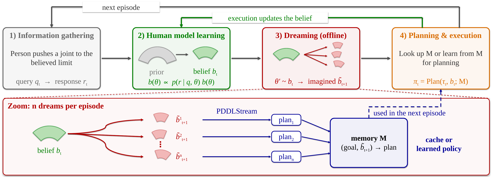
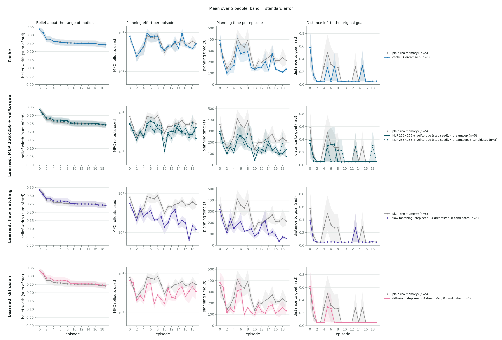

> README of `main` at 8b385ea (2026-10-27): the limb-only dream pipeline before the
> multi-task refactor. Code links point to that commit; its results are on W&B (tag `archive`).

# ABLE: Anticipating Belief Updates for Learning Efficient TAMP

**Motivation:** A robot moves a person's arm to a goal pose by forceful contact, as in caregiving
or rehabilitation. Where to stand, where to grasp and how to move the limb can be considered as a Task and
Motion Planning (TAMP) problem. The difficulty is that each person's **range of motion**
(RoM) is different and unknown, so the planner is slow: it has to search for torques that
keep the limb inside limits it is not sure about.

**Goal:** for a new person, learn their range of motion and learn to plan faster for them.

**Idea (dreaming):** the robot keeps a *belief* over the person's RoM. Between real
episodes it imagines how that belief might change next, solves tasks under those imagined
beliefs with the slow planner, and stores the solutions in a memory. Dreamed results can be used to learn a model $g$ that predicts the warm start for the planner. When the real episode
comes, the planner can generate plan faster using $g$.



More background: [NERC abstract](presentations/NERC_Abstract.pdf) ·
[NERC poster](poster/nerc_poster_9_48x36_preview.pdf)
([pptx](poster/nerc_poster_9_48x36.pptx)) ·
[lab meeting slides](<presentations/Lab Meeting 260909.pptx>)

## Install

The project builds on three other repos:

| Repo | Description |
| --- | --- |
| [kindergarden](https://github.com/Princeton-Robot-Planning-and-Learning/kindergarden) | LimbRepositioning3D environment |
| [pddlstream](https://github.com/Princeton-Robot-Planning-and-Learning/pddlstream) (PRPL fork) | The TAMP planner the pipeline uses. Installed automatically with kinder-baselines. |
| [kinder-baselines](https://github.com/Princeton-Robot-Planning-and-Learning/kinder-baselines) | Contains domain pddl, stream pddl, and stream functions the PDDLStream planner uses to solve  LimbRepositioning3D tasks. |


```bash
git clone https://github.com/Minseo10/learning-forceful-manipulation
cd learning-forceful-manipulation

conda create -n kinder python=3.11 && conda activate kinder
# Build tools: the planner (FastDownward) and the robot's IK (IKFast) are compiled locally.
conda install -c conda-forge cmake make cxx-compiler openblas libgfortran5

# -Wno-template-body lets GCC 15 build FastDownward.
CXXFLAGS="$CXXFLAGS -Wno-template-body" pip install -e ".[develop]"

pytest -m "not slow"        # quick check: 62 tests, a few seconds
```

- pip fetches kindergarden and kinder-baselines from their `main` branches. To use editable version, clone them beside
this repo and run `pip install -e ../kindergarden -e ../kinder-baselines/kinder-models
-e ../kinder-baselines/kinder-pddlstream-planning` afterwards.

- IKFast compiles itself the first time the planner runs and looks for LAPACK/BLAS in system
folders. Point it at the conda ones once, before the first run:

    ```bash
    L=$CONDA_PREFIX/lib/ikfast-link && mkdir -p $L
    ln -sf $CONDA_PREFIX/lib/libopenblas.a $L/liblapack.a
    ln -sf $CONDA_PREFIX/lib/libopenblas.a $L/libblas.a
    ln -sf $CONDA_PREFIX/lib/libgfortran.so.5.0.0 $L/libgfortran.so.5.0.0
    export LAPACK_DIR=$L BLAS_DIR=$L LIBGFORTRAN_DIR=$L
    export LDFLAGS="-Wl,-rpath,$CONDA_PREFIX/lib -lgomp -lpthread"
    ```

    Then run the short test in [Run](#run) in the same shell. After IKFast has built, the
    exports are no longer needed.

## Pipeline

**Human parameter `theta`:**
- The simulated person has a parameter `theta`: how far three left-arm motions
(shoulder flexion, shoulder abduction, elbow flexion) can go, as a scaled value of the default
ROMs ([figure](figures/rom_definition.png)). 

**Planner's parameter `psi`:**
- The planner `plan-limb-motion` stream uses MPC to search for robot torques that manipulates limb to the goal configuration. `psi` is the warm start (initial robot torque distribution) for the MPC. By default it is zero, so the search starts from
scratch every time.
- Learning to plan means learning a model $g$ that predicts a good `psi`. The learned model predicts them from the current state,
goal and belief. A good seed lets the MPC find a plan with fewer rollouts.0
- For now `psi` is a warm start just for `plan-limb-motion` stream, but it can be extended to warm start for other streams for future work.


Each **episode** runs these following steps, all driven by
[`dream_pipeline.py`](https://github.com/Minseo10/learning-forceful-manipulation/blob/8b385ea/src/limb_baseline/dream_pipeline.py):

| Step | What happens | Code |
| --- | --- | --- |
| 1. Information gathering | The robot queries human and collect responses (Query: The robot asks the person to push a joint to the believed limit. Response: Human's final limb configuration.) | [`queries.py`](https://github.com/Minseo10/learning-forceful-manipulation/blob/8b385ea/src/limb_baseline/queries.py) |
| 2. Human model learning | Keep a belief over `theta`. It starts at a population prior and the belief is updated after information gathering using human responses. | [`belief.py`](https://github.com/Minseo10/learning-forceful-manipulation/blob/8b385ea/src/limb_baseline/belief.py), `observe()` |
| 3. Dreaming | Repeat `n_dreams` times: draw a random person from the belief, plan a task for them, imagine executing it, and get the belief that would follow. Store the plan in the memory under that imagined belief. | `dream_once()` |
| 4. Planning and execution | Run PDDLStream planner, with using $g$ that predicts the warm start for MPC. If its plan does not work, search with the normal planner (PDDLStream without $g$). Execute on the real person, then update the belief. | `plan_and_execute()`, [`planner.py`](https://github.com/Minseo10/learning-forceful-manipulation/blob/8b385ea/src/limb_baseline/planner.py), [`memo.py`](https://github.com/Minseo10/learning-forceful-manipulation/blob/8b385ea/src/limb_baseline/memo.py) |

`--condition` represents what the memory selects:

- `plain`: no memory and no dreams. The baseline.
- `cache`: Just reuse the plan saved in the memory. A table from (goal, belief) to a stored plan.
- `learned`: a model that predicts torques from the current state and goal, retrained
  after every solved dream or episode. 
    - `--model` picks it: an MLP
  ([`warmstart.py`](https://github.com/Minseo10/learning-forceful-manipulation/blob/8b385ea/src/limb_baseline/warmstart.py)) or a generative model such as flow
  matching or diffusion ([`generative.py`](https://github.com/Minseo10/learning-forceful-manipulation/blob/8b385ea/src/limb_baseline/generative.py)).


## Run


```bash
python -m limb_baseline.dream_pipeline --condition learned --model gen:flow:hist \
    --n-dreams 4 --num-episodes 20 --person 24 --fresh-goals --vary-geometry \
    --seed-mode step --seed-rollouts 8 --out data/dream/my_run/flow_p24.csv
```

- For a quick test (about 10 minutes) use `--num-episodes 2 --n-dreams 1 --max-time 120
--dream-max-time 120`.

- It writes `flow_p24.csv` (one row per episode), `flow_p24_dreams.csv` (one row per dream),
`flow_p24_learning.jsonl` (model error after each retraining) and a checkpoint;
`--resume` continues an interrupted run. Each plan may take up to 10 minutes, so a
20-episode run with dreams takes hours.

A full experiment is 5 people for every condition, run in parallel (at most 16 processes),
followed by the figures:

```bash
scripts/run_dream.sh warmstart 20 4    # 6 goals that repeat        -> data/dream/warmstart_compare
scripts/run_dream.sh fresh 20 4        # a new goal every episode   -> data/dream/fresh_goals
MODELS="gen:flow:hist gen:ddpm:hist" scripts/run_dream.sh generative 20 4
                                       # generative models, 8 candidates -> data/dream/generative_models
```

The arguments are episodes and dreams per episode; the header of
[`run_dream.sh`](https://github.com/Minseo10/learning-forceful-manipulation/blob/8b385ea/scripts/run_dream.sh) lists the other options. To redraw figures from
existing runs:

```bash
python scripts/dream_figures.py summary --csv data/dream/generative_models/*_p??.csv \
    --out figures/dream/generative_models/summary.png --per-person
```

## Expected results

With a useful memory, planning should get **cheaper than `plain` as episodes go on**
(fewer MPC rollouts, less planning time), while the arm still reaches the goal (distance
to goal stays near zero) and the belief narrows.

Results with 5 people, 20 episodes, 4 dreams per episode.
Each row compares one memory against `plain` (grey). Flow matching has the best performance so far.



Mean over episodes 10-19:

| Memory | MPC rollouts | Planning time (s) | Goal reached |
| --- | --- | --- | --- |
| plain | 5082 | 216 | 94% |
| cache | 5031 | 157 | 96% |
| MLP | 3340 | 126 | 98% |
| MLP, 8 candidates | 3173 | 137 | 94% |
| diffusion, 8 candidates | 3374 | 140 | 100% |
| flow matching, 8 candidates | 1868 | 107 | 96% |


## Files

| Path | What |
| --- | --- |
| `src/limb_baseline/dream_pipeline.py` | The episode loop: belief update, dreams, memory, planning |
| `src/limb_baseline/belief.py`, `human.py` | Belief over the range of motion; the person model `theta` |
| `src/limb_baseline/planner.py`, `memo.py` | Planner wrapper; plan cache, online model and MPC seeding |
| `src/limb_baseline/warmstart.py`, `generative.py` | The learned models (MLP; flow matching, diffusion and others) |
| `scripts/run_dream.sh` | Runs a full experiment |
| `scripts/dream_figures.py` | Result figures: `summary`, `curves`, `step`, `samples` |
| `scripts/dream_eval.py` | Offline studies of the models on recorded runs |
| `scripts/log_to_wandb.py` | Uploads results to Weights & Biases |
| `data/dream/`, `figures/dream/` | Current runs and their figures, one folder per experiment |
| `data/archive/`, `figures/archive/` | Earlier runs and figures |
| `doc/` | Poster, abstract, slides, [earlier experiments](earlier-experiments.md) |
| `notebooks/dreaming_rom_planner.ipynb` | The toy version of the loop this pipeline follows |
| `tests/` | `pytest -m "not slow"` skips tests that build a simulation |
