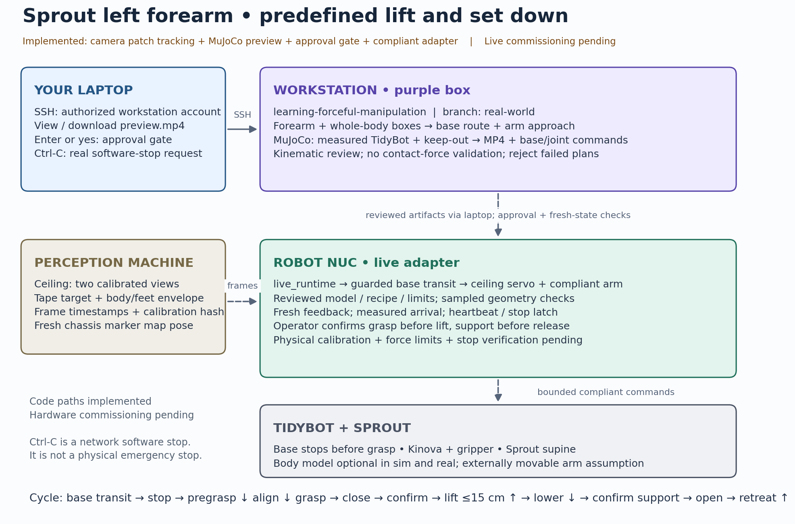

# Sprout real-world pick-and-place

- **Start here:** [real → sim → real guide](docs/real-to-sim-to-real.md) for setup, commands, configuration and shutdown.
- **Task:** localize the taped left forearm of supine Sprout → plan base/arm motion → preview → approve → grasp, lift up to 15 cm, lower, release and retreat.
- Uses TidyBot's **JointCompliantController** and ceiling visual alignment. No full ABLE pipeline, Sprout motor commands or active assistance. Sprout model alignment is optional. Default geometry is forearm/body boxes.
- Implementation and offline tests are available. Physical force/clearance/stop commissioning and a passing fresh-state plan are required before real execution.



## Layout and implemented code

```text
real_world/
├── src/sprout_experiment/   # workstation orchestration and preview
├── scripts/                # laptop helper, workstation launchers, packaging
├── config/                 # example detection/scene/commissioning configuration
├── tests/                  # workstation workflow and transport tests
└── docs/                   # real-to-sim-to-real.md and architecture image
```

| Machine | Implementation |
|---|---|
| Operator laptop | `scripts/sprout_laptop.py`: deploy, camera tunnel, robot-state capture, video download, approval/confirmations, Ctrl-C/heartbeat stop and shutdown. |
| Workstation (purple box) | `src/sprout_experiment/rehearsal.py`, `live_bundle.py`, `client.py`, `model.py`. `scripts/sprout_sim.sh`: detect/project, build measured-state preview and bind review artifacts. |
| TidyBot NUC | Companion repo `src/prpl_tidybot/sprout/`: `live_runtime.py`, `live_perception.py`, `live_kinematics.py`, `live_config.py` connect fresh feedback, map FK/IK, geometry guards and commissioning. |
| NUC motion/planning | `compliant_arm.py`, `compliant_backend.py`, `sequence.py`. `body_obstacle.py`, `base_planning.py`, `base_motion.py`: compliant cycle and guarded base transit. `review.py`/`remote_execute.py` handle approval. `read_robot_state.py`/`shutdown_arm.py` handle feedback/retraction. |
| Perception PC | TidyBot camera/marker publishers provide immutable frames/poses with acquisition timestamps and calibration fingerprints. |

- Paths in the first two rows are relative to `real_world/`. Robot module names are relative to the companion TidyBot package.
- Shared camera and controller code stays in TidyBot. This stack reuses cube calibration with ceiling XY alignment.
- Python imports use `sprout_experiment`. Use the paths above, not the removed compatibility paths.

## Storage and branches

- Workstation branch: `real-world`.
- TidyBot branch: `minseo/sprout-predefined`. Deployment creates isolated `minseo/sprout-build.*` worktrees.
- Open PRs and request review to Yixuan or Tom.
- Root `.local/sprout/` holds calibration, captures and outputs. Root `private_sprout/v0.1.4/` holds optional private models. Both are ignored. Private Sprout assets are never deployed or uploaded to GitHub.

## Offline validation

```bash
PYTHONPATH=real_world/src:../prpl-tidybot/src python -m pytest real_world/tests
bash real_world/scripts/sprout_sim.sh check
```

- Use the configured Python environment with MuJoCo/OpenCV. These commands do not activate hardware.
- Tests cover fake-feedback cycles, approval/confirmation and stop faults, geometry checks and workflow packaging. Set `SPROUT_TIDYBOT_REPO` to the companion checkout to include synthetic localhost RPC tests.
- Simulation is kinematic. It does not validate contact forces. See the run guide for historical diagnostics and physical commissioning requirements.
