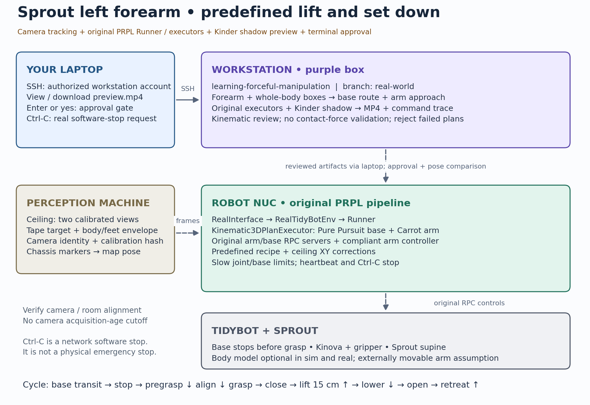
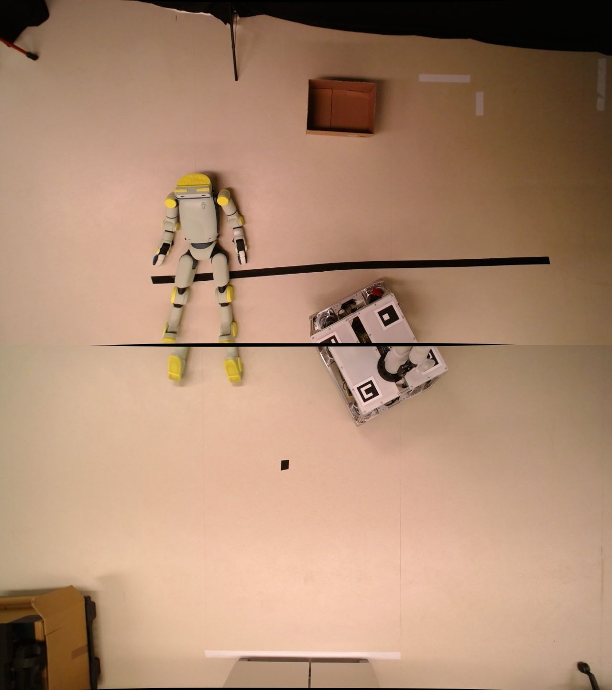

# Simple pick-and-place: real → sim → real

- Simple predefined limb repositioning of a Sprout robot using TidyBot. No ABLE pipeline or Sprout motor commands.
- Capture scene → read TidyBot state → simulate → review → approve → execute.
- Uses main's arm/base RPC servers, `RealInterface`, `RealTidyBotEnv`, `Runner`, `Kinematic3DPlanExecutor`, Pure Pursuit and Carrot arm executors. Sprout code supplies perception and the predefined recipe.
- Preview replays the same executors offline and renders through main's `KinderSimEnv` shadow simulator. It does not run ABLE.



## 0. Before Starting

### Physical Setup

- **Turn on TidyBot** using the [power-up steps](#2-power-up-and-deploy).
- Place **Sprout** on its back on the ground. Keep the white tape on the intended left-forearm grasp visible to the ceiling cameras. TidyBot can be placed a little bit farther to the Sprout.



### About Safety

- **Always check the simulation video. If the robot motion looks wrong or seems to collide to somewhere else, DO NOT execute on the real robot.**
- **Ctrl-C in the execution terminal** if things go weird. Temporary E-stop.

### Things to know
- Planning depends on TidyBot's starting pose. If it is too close, stop the session, position it a little farther from Sprout and rerun preview. This may help reachability but will not fix calibration or joint-limit errors.
- Current code does not require Sprout model (urdf, mjx, meshes), but if you want to use Sprout model, see [private model setup](#optional-private-sprout-model-setup).
- Commands run on your **laptop** unless marked **workstation** or **NUC**. Requires Python 3.10+, Bash, SSH and SCP on Linux, macOS or Windows/WSL. Outside macOS, open the downloaded video manually.


## 1. Laptop and workstation setup

### 1.1 Laptop: connect to the workstation

- Ask the workstation administrator to create your account and enable SSH access.
- Connect to **PRPL lab TP-Link Wi-Fi**. Ask @Minseo10 for Wi-Fi and server credentials. Keep passwords out of files and Git.
- Replace `YOUR_USERNAME`, then connect. Enter your workstation password if prompted:

    ```bash
    ssh YOUR_USERNAME@100.83.23.79
    ```

### 1.2 Workstation: prepare your account once

- Clone them under your own account

    ```bash
    mkdir -p ~/research
    cd ~/research
    git clone --branch real-world https://github.com/Minseo10/learning-forceful-manipulation.git
    git clone --branch minseo/sprout-predefined https://github.com/Princeton-Robot-Planning-and-Learning/prpl-tidybot.git
    git clone https://github.com/Princeton-Robot-Planning-and-Learning/kindergarden.git
    ```

- Create your Conda environment on the workstation
    ```bash
    conda create -n sprout python=3.10 pip -y
    conda activate sprout
    cd ~/research/learning-forceful-manipulation
    python -m pip install -r real_world/requirements-workstation.txt
    ln -s "$CONDA_PREFIX" .venv
    bash real_world/scripts/sprout_sim.sh setup
    ```

- Setup now checks the PRPL URDF assets and builds Kinova IKFast if needed. On a Linux workstation missing its build dependencies, install them once and rerun setup:

    ```bash
    sudo apt-get install build-essential liblapack-dev libblas-dev libgfortran5
    bash real_world/scripts/sprout_sim.sh setup
    ```


### 1.3 Laptop: save settings and download the helper

- Replace `YOUR_USERNAME` with your account username, then run:

    ```bash
    cat > ~/.sprout-env <<'EOF'
    export SPROUT_WORKSTATION='YOUR_USERNAME@100.83.23.79'
    export SPROUT_REPO='/home/YOUR_USERNAME/research/learning-forceful-manipulation'
    EOF
    source ~/.sprout-env
    scp "$SPROUT_WORKSTATION:$SPROUT_REPO/real_world/scripts/sprout_laptop.py" ~/sprout.py
    ```

- Enter the workstation password if prompted. Run `source ~/.sprout-env` in **each new laptop terminal**. Repeat `scp` after helper updates.
- Lab defaults: NUC `tidybot@192.168.0.76`, perception SSH `yixuan@192.168.0.131`, perception address `192.168.0.131`. Override with `SPROUT_NUC`, `SPROUT_PERCEPTION_SSH` and `SPROUT_PERCEPTION` in `~/.sprout-env` if needed. CLI flags override these settings.


## 2. Power up and deploy

- **Physical power-up:** chargers disconnected → SLA connected/switched on → camping battery on in AC mode (NUC boots) → arm power button. Follow [Josh's onboarding](https://github.com/Princeton-Robot-Planning-and-Learning/prpl-tidybot/blob/b72db08443771160a845f1f816e7847cf214bba6/docs/onboarding/onboarding.md).
- Install on the NUC/perception PC **once initially and after robot-code updates**, not on every run:

    ```bash
    python3 ~/sprout.py deploy
    ```


- After this pipeline update, rerun `python -m pip install -r real_world/requirements-workstation.txt` in the **workstation's activated environment**, then deploy again.

### Start services with the standard launcher (laptop)

```bash
cd ~/prpl-tidybot
export PRPL_NUC_HOST=tidybot@192.168.0.76
export PRPL_PERCEPTION_HOST=yixuan@192.168.0.131
./scripts/launch.sh minseo/sprout-predefined
```

- Use the updated `minseo/sprout-predefined` checkout on your laptop. If it is absent, clone that branch first.
- Leave tmux running. The launcher starts the arm server, base server and perception server. Run the commands below in a separate laptop terminal.
- **Do not also run `sprout.py servers` or `sprout.py perception` when the launcher has started them.** Stop your old server processes before restarting after updates. Do not overwrite another user's remote edits.

## 3. Alternative: start services without the standard launcher

- Skip this section if `launch.sh` is already running all services.
- In one laptop terminal:

```bash
source ~/.sprout-env
python3 ~/sprout.py servers
```

- In another laptop terminal:

```bash
source ~/.sprout-env
python3 ~/sprout.py perception
```

- Enter the perception-PC SSH password if requested. Leave this terminal running.
- Ctrl-C the old perception process before restarting. For `Address already in use`, stop the existing owner rather than launching duplicates.

### First run only: initialize tracking (laptop terminal 2)

- Keep services running. In a separate laptop terminal, load your settings, download the latest helper, then initialize tracking:

    ```bash
    source ~/.sprout-env
    scp "$SPROUT_WORKSTATION:$SPROUT_REPO/real_world/scripts/sprout_laptop.py" ~/sprout.py
    python3 ~/sprout.py init
    ```

## 4. Capture and preview (laptop terminal 2)

```bash
source ~/.sprout-env
python3 ~/sprout.py
```

- Captures camera → reads current joints/map pose → detects taped forearm/body → searches base poses/routes → renders actions → downloads `~/Downloads/sprout-preview.mp4`. Open the file manually if a player does not launch.
- Also downloads `~/Downloads/sprout-map-overlay.png`: gray 0.5 m map grid, orange room-model footprints, target and base path projected onto the camera image. **Verify that the room footprints match the real room before execution.** The default room placement is not fitted from the ceiling image.
- Start here on later runs if deployment is current and perception is running.

## 5. Preview, approve and execute (laptop terminal 2)

```bash
python3 ~/sprout.py --execute
```

- Repeats the fresh preview. Only a successful, validated review allows **Enter/yes** after watching the video.
- Before execution, read the current robot/target state and compare it with the preview. Camera acquisition-age checks are disabled by request. Connection/detection failures, pose comparison, controller watchdogs and Ctrl-C stop remain active.
- Existing Pure Pursuit base transit → pregrasp → ceiling XY alignment → descend → close and dwell → lift 15 cm → lower → open and dwell → retreat. There are no added grasp/support confirmation prompts.


## 6. Stop or shut down
- After a code update, refresh the laptop helper and deployed code once:

    ```bash
    source ~/.sprout-env
    scp "$SPROUT_WORKSTATION:$SPROUT_REPO/real_world/scripts/sprout_laptop.py" ~/sprout.py
    python3 ~/sprout.py deploy
    ```

- For normal shutdown, use a **separate laptop terminal outside tmux**, with Sprout supported/released and the entire retract sweep clear:

    ```bash
    source ~/.sprout-env
    python3 ~/sprout.py shutdown
    ```

- Type `shutdown`: run `hardware_tests/test_arm_retract.py --shutdown` on the NUC and verify retraction → run Josh's `stop_servers.sh` from the laptop, outside tmux.
- Retract uses the running arm server, or the stored Kinova Retract action when no arm server is running. An active Sprout/teleop session or retract failure stops the sequence before server teardown.
- Verify stable retraction, then type `poweroff`. The helper runs `sudo poweroff` on the NUC. Enter its password if requested. Server teardown failure prevents poweroff. Battery and arm power switches remain manual.
- After the NUC is off manually power off TidyBot. Follow [Josh's onboarding](https://github.com/Princeton-Robot-Planning-and-Learning/prpl-tidybot/blob/b72db08443771160a845f1f816e7847cf214bba6/docs/onboarding/onboarding.md).

## Optional private Sprout model setup

- Sign in to [Fauna documentation](https://docs.faunarobotics.com/doc/introduction/) and check **Development → Simulation** for the archive. If unavailable, ask @Minseo10 for the authorized `sprout-model-v0.1.4.zip`.
- **On the workstation**, from the experiment repository root:

    ```bash
    mkdir -p private_sprout/v0.1.4
    unzip ~/sprout-model-v0.1.4.zip -d private_sprout/v0.1.4
    ```
- **NEVER UPLOAD Sprout models or their archive to GitHub.** `private_sprout/` is ignored and excluded from deployment. Keep them outside tracked code.


## Commissioning inputs

- Settings are in the workstation repo's `.local/sprout/` folder. Edit them if needed, then generate a new preview.
- **`live.json`:** arm/base speeds, gripper force/speed, floor clearance, collision bounds and stop thresholds. RPC speed limits: arm joints **5°/s**, base **2 cm/s**, gripper force/speed **10%** (driver commands, not measured contact force).
- Missing/null `hardware.measured_torque_limit_nm` fills automatically with `[39, 39, 39, 39, 9, 9, 9]` N·m (joints 1–7). These are Gen3 joint soft limits from [Kinova Table 44](https://www.kinovarobotics.com/uploads/User-Guide-Gen3-R07.pdf#page=104), retained for legacy adapter compatibility. The main RPC path uses its existing hardware/controller protection. These values do not bound Sprout contact force.
- **`detection.json`:** camera calibration, tape tracking and forearm height. Grasp position/orientation update automatically.
- **`scene.json`:** lift/pregrasp distances, base planning and optional Sprout model paths.
- Default `base_planning.bounds_xy` is `[[-2.0, -1.3], [2.0, 2.0]]`. Setup preserves existing `.local/sprout/scene.json`, so an existing installation must update this field locally once. Use bounds matching the clear operating area and generate a fresh preview.
- Planning uses PRPL’s `TidyBotKinova` URDF collision geometry, the original static PRPL room, base BiRRT and arm IK/path planners. Sprout stays as boxes. The preview replays the original executors against this plan. Regenerate old previews after updating.
- Templates are in `real_world/config/`. Missing speed, torque and model-derived floor settings fill automatically. Older faster speeds are capped at the slow limits above. Slower custom speeds and other configured values are preserved.
- Manual `obstacles` and `held_forearm` boxes are optional. Missing/null placeholders are skipped. Legacy `verified`, `execution_enabled` and `navigation.verified` fields no longer gate execution. A successful fresh preview and terminal approval are required.

## Outputs

- Workstation `.local/sprout/detection/`: `detection.png`, `target_closeup.png`, `body_obstacle.png`, `observation.json`.
- `.local/sprout/camera-preview/`: video, `map-overlay.png`, joint trajectory, `executor-trace.json` (commands produced by the original executors), scene/base path, live config and hashed review.
- Laptop video: `~/Downloads/sprout-preview.mp4`.

## Limitations

- **Current:** detects the taped forearm grasp region for predefined pick-and-place. The coarse body keep-out box is not whole-body pose estimation.
- **Goal:** estimate Sprout's whole-body pose from its model and camera views → reconstruct it in simulation → plan with ABLE → execute the reviewed plan on the real robot.
- The camera whole-body box protects the base. It is excluded from arm collision checks so the gripper can reach the target. Without optional manual arm/held-forearm boxes, arm-to-Sprout and attached-limb collisions are not checked. Planning checks robot self-collision and floor clearance. The main RPC path applies joint-speed limits and controller watchdogs.
- This is a kinematic rehearsal with fake feedback and a Kinder shadow renderer. It does not predict contact forces, compliant tracking error or actual wall-clock motion duration. The main arm executor limits joint speed, not an independent Cartesian tool-speed cap.
- Camera calibration and the room model's default placement are separate. A similar room shape does not establish wall alignment. Room-model collisions cannot protect against a real wall whose location differs from the model.
